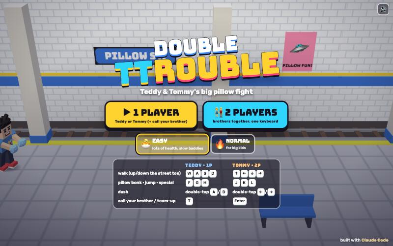

# Double TTrouble

[](https://adong.github.io/brawler-tt/)

Press **?** any time (or tap the round **?** button on the left edge) to see the keys. The game waits while you look.
Tap **中文 / EN** under it to switch between English and 中文 (the dashboard and every game remember the choice).

A side-scrolling co-op brawler starring Teddy and Tommy, in the spirit of the old arcade street brawlers, except it's a big silly pillow fight. It's built with Claude Code from plain JavaScript and Three.js, on the shared Claude Games kit.
There are no image, model or audio files: the brothers and the gang are the kit's blocky characters, every texture is painted on a canvas, and every sound is synthesised.

**The story:** the Grumble Gang snatched every pillow in town. Teddy and Tommy walk the streets with a pillow in hand (Teddy has one in each fist) to get them back.

It's silly, not violent. Hits make comic POW! bursts, feathers and a bonk. A knocked-out baddie sits down dizzy with stars and a chick circling his head. Then he gets up, waves a little white flag and goes POOF.

The name lives in one place, `js/title.js`, so it's easy to change. "Double TTrouble" is a working title.

## Play

- **Double-click `index.html`.** It works offline: Three.js and the kit are copied into `kit/`. Without internet the title font falls back to Arial Black.
- **Send one file:** `dist/brawler-tt.html` is the whole game inlined. AirDrop or email it, then open it in a browser.
- Rebuild that file after any edit: `python3 kit/tools/bundle.py . --name brawler-tt`

**1 PLAYER:** pick Teddy or Tommy. The other brother is one tap away (see *Call your brother* below).
**2 PLAYERS:** the brothers together on one keyboard, or side by side on one iPad.

Pick the difficulty on the title screen:

- **🐣 EASY**, for little fighters like Tommy (5):
  - 150 health and 5 lives, and as many continues as you like.
  - Fewer baddies (a quarter of each wave stays home), only one attacks at a time, and they're slower.
  - Each baddie shows its "!" for longer before it attacks, hits for less than half as much, and has 60% of the health.
- **🔥 NORMAL**, for big kids like Teddy (8): 100 health, 3 lives, 2 continues, and up to two baddies attack at once.

## Controls

| | Teddy (player 1) | Tommy (player 2) | Touch |
|---|---|---|---|
| walk (left/right and up/down the street) | W A S D | ← → ↑ ↓ | joystick |
| pillow bonk | F | J | 👊 BONK |
| jump | G | K | ⬆️ JUMP |
| special | H | L | ⭐ (🏀 / ✌️) |
| dash | double-tap A or D | double-tap ← or → | flick the joystick sideways twice |
| call your brother (1P) / team-up (2P) | T | Enter | tap his face (1P) or the TEAM-UP! button (2P) |

- In 1-player mode both key sets drive you, so arrows + J K L work too, and Space jumps.
- **P** or Esc pauses and **M** turns the sound on or off. The ❚❚ and 🔊 buttons at the top do the same.
- **Menus:** on the title, Enter (or F/J) starts 1 player and 2 starts 2 players. ← → switch EASY/NORMAL, and S opens the stage select once you've cleared a stage. On *Who's playing?*, ← → and Enter. Esc goes back.
- **Touch:** the joystick and buttons appear on the first touch. In 2 players, Teddy's controls are on the left and Tommy's on the right, so two kids can share one iPad.

## Moves

| Move | How | |
|---|---|---|
| Pillow combo | bonk, bonk, bonk | **Teddy**: Tyson-style jab and straight with a pillow in each fist, then a double-pillow hook (WHUMP!). **Tommy**: pillow bop, bop and a big overhead FLOMP!. The third hit knocks down. |
| Jump kick | jump, then bonk in the air | a flying kick that knocks down |
| Dash + tackle | double-tap a direction to run, bonk while running | a running pillow tackle (WHOOSH!) |
| Grab and toss | walk into a baddie | grab him, then bonk, bonk, and the third bonk throws him. Jump (or hold away + bonk) throws him over your shoulder. A thrown baddie bowls over anyone he hits (STRIKE!). Bosses can't be grabbed. |
| Special | special | **Teddy's 🏀 SLAM DUNK:** he leaps up with a basketball and slams it down in front of him; the BOING! shockwave knocks down everyone near it. **Tommy's ✌️ PEACE WAVE:** his Y pose sends a ring of ✌️ and ⭐ out all around him. A special costs a little health (8 on normal, 5 on easy) but never your last point, and you can't be hit while you do it. |

Pick-ups are things lying in the street, or hidden in boxes, bins and presents you bonk open:

- **To swing:** 🪶 the BIG PILLOW (long reach), 🐔 the RUBBER CHICKEN (fast, SQUAWK!) and 🏏 the FOAM BAT (WHAM!, always knocks down). Walk over one to pick it up. The HUD shows how many hits it has left before it goes POOF (the pillow bursts into feathers). If you get knocked down you drop it.
- **Food heals:** 🍉 +40, 🍦 +30, 🍪 +20. Baddies sometimes leave a snack behind.

## Call your brother (companion mode)

In 1 player, the other brother is always there for you. Press **T** or tap his big face in the top-right corner, as often as you like.

- **He runs in** from the left and says hi with his signature move (it bonks baddies close by):
  - Teddy shadow-boxes, Tyson style.
  - Tommy does his Y pose with ✌️.
- **He hands you a treat:** a 🍦 💧 🧃 🍪 🍉 or 🍌 flies over with a toast like **"🍦 ICE CREAM FROM TOMMY!"**, and gives back 20 health.
- **He fights beside you** for about 10 seconds. His face card shows a green bar for the time he has left.
- **He's got your back:** while he's there, the next hit on you is blocked (the 🛡️ SAFE chip), with a **"TOMMY SAVED YOU!"** and the baddie bounces off dizzy.
- **Tap again while he's there** for another treat. That also restores the block and starts his 10 s over.
- When his time's up he does his goodbye move (Teddy's 🏀 jump shot, Tommy's Y) and runs off. You can call him straight back.

In 2 players the button is a **TEAM-UP!** instead. Both brothers do their signature moves at once, the slam dunk and the Y pose together, and KA-BOOM: every baddie on screen gets bonked, and a boss loses a big chunk of health. Then it cools down: 25 s on normal, 15 s on easy. The button glows when it's ready.

## Stages

Six stages, each with a boss at the end.

| | Stage | Gang | Boss |
|---|---|---|---|
| 1 | 🌳 Sunny Park | hoodie zombies, gremlins | **BIG GRUMBLE**, king of the gremlins: swipes, a jumping STOMP (jump over its shockwave!), calls gremlins |
| 2 | 🚇 Subway Platform (trains zoom past) | zombies, robots | **DJ ZOMBIE**: throws 🎵 notes (step up or down the street to dodge), calls zombies |
| 3 | 🏙️ Rooftop at sunset | robots, gremlins | **ROCKET BOLT**: jetpack swoops, throws 🔩 bolts |
| 4 | 🛍️ The Mall | everyone | **MEGA BOLT**: ⚡ zap beam along his lane, a charge |
| 5 | 🏀 School Gym | everyone | **ZOMBIE COACH**: throws 🏐 dodgeballs, charges, blows his whistle for help |
| 6 | 🏰 Zombie Castle | everyone | **KING ZOMBIE** (crown and cape): stomps, throws 🥧 pies, calls zombies |

- **How a stage goes:** the screen scrolls right as you walk, stops at each fight, and shows **GO ➜** when the street is clear. A boss gets his own health bar with his portrait.
- **Bosses:** small hits don't stop them, but the third hit of a combo makes them stagger and a special knocks them down. Below half health they get 💢 and attack more often.
- **When the boss is bonked**, everyone else gives up and waves their white flags. Then comes the celebration:
  - Teddy shadow-boxes and sinks a 🏀 jump shot, while Tommy does his Y pose under ✌️ and ⭐.
  - Then the brothers **HIGH FIVE!**
  - In 1 player, the other brother runs in for it.
- **Unlocking:** clearing a stage unlocks the next one, and the 🗺️ STAGES picker appears once you've cleared one. Progress is saved in the browser (localStorage key `doubleTTrouble.v1`).
- **Health, lives and continues:** health bars with portraits and ❤️ lives are at the top. When you're out of lives it's **CONTINUE?**: as many as you like on easy, 2 on normal with a 9-second countdown. In 2 players, a brother who's out of lives can tap bonk to jump back in (uses a continue) while the other one keeps fighting.

## Make it yours

- **`js/stages.js`:** the six stages, in plain words. For each section: where the screen stops, the waves of baddies (`enemies: ['zombie', 'gremlin']`, `from: 'left'`), things lying in the street (`items`) and boxes to bonk open (`crates`, with what's inside). Add a wave, move a boss, put a watermelon somewhere.
- **`js/rules.js`:** every number.
  - Each move's reach and damage, the weapons, food, the specials.
  - Every baddie and boss: health, speed, attacks, colours.
  - The treats, the companion's visit length, and the two difficulty levels.
- **`js/title.js`:** the game's name.
- Run `node tools/check.js` after any change to `js/stages.js` or `js/rules.js`, to make sure every stage can still be cleared.

## How it works, and how it's tested

- **The engine** (`js/sim.js`, with the baddies' and companion's brains in `js/brains.js`) has no Three.js or DOM in it. A stage is plain state stepped 60 times a second, and the same code runs the browser game and the headless check.
  - Every fighter is a little state machine: idle, walk, run, attack, jump, grab, held, hurt, down, lying, getup, dizzy, white flag.
  - Baddies take turns attacking, like in the arcade: on normal the closest two may attack and the rest hang back. A second attacker comes round your other side.
  - Every baddie shows a "!" before it attacks.
- **The renderer** (`js/game.js`) only reads that state, and turns the engine's events into POW bursts, feathers, sounds, toasts and camera shake. A bot-played demo runs behind the title screen.
- **`node tools/check.js`** (about 3 s). It loads the real engine files in node and checks two things:
  - **The moves, one at a time (15 checks):** Teddy's and Tommy's combos, grab, bop and toss, the STRIKE! bowl-over, the jump kick, dash tackle, weapons breaking, food, the special's health cost, the peace wave, the companion (treat, block, leaving, calling again), the team-up, and lives then continue.
  - **A bot plays every stage in 8 set-ups:** 1P Teddy, 1P Tommy, with and without the companion, 2P, 2P with team-ups, easy and normal, plus a sloppy "little kid" bot that reacts slowly, never dodges and never uses a special.
  - Every step it checks for NaN and that nobody is off-screen, apart from a baddie still walking in, who must make it in within 6.5 s. It also checks that everyone stays on the street, the screen never stays locked with nothing to fight, and the camera never stalls.
  - `--soak 10` adds 10 random seeds per stage and set-up. At the last run it was 543 of 543 runs clear.
  - `--prove` shows the check can fail: an idle player can't clear stage 1, and a baddie pushed off-screen is caught.
  - On easy, the kid bot clears every stage without losing a life. On normal it loses 1 to 4 lives a stage and sometimes needs a continue.
- **Console hooks (`window.game`)** for testing in a browser:

```js
game.start({ stage: 5, mode: '2p', difficulty: 'easy' })  // jump straight into a stage
game.step(2)          // advance 2 s and draw (when the tab's animation is throttled)
game.hold(true)       // stop the live loop so only step() moves time
game.autoplay(true)   // let the test bot play the brothers through the real renderer
game.warp(3)          // jump to section 3 (the last section is the boss)
game.call()           // call your brother / team-up
game.state()          // phase, heroes, enemies, buddy, boss...
game.quiet()          // hide banners and toasts for a clean screenshot
game.autoPause = false
```

## Files

```
index.html        the page: HUD, menus, touch controls (CSS inline)
js/title.js       the game's name
js/rules.js       moves, weapons, food, specials, the gang and the bosses, treats, companion, difficulty
js/stages.js      the six stages: sections, waves, items, crates
js/sim.js         the engine: fighters, combat, grab and toss, specials, companion, team-up, sections, camera, lives
js/brains.js      the gang's and bosses' moves, the companion's AI, the test bot
js/input.js       keyboard for two players, two touch joysticks and button sets
js/poses.js       brawler poses on top of Kit.people.pose
js/scenery.js     park, subway, rooftop, mall, gym, castle (and their bonk-open boxes)
js/fx.js          POW bursts, feathers, poof clouds, shockwave rings, flying treats, confetti
js/sfx.js         pillow-fight sounds on top of Kit.sound
js/game.js        scene, camera, models (pillows, weapons, crowns...), HUD, menus, events, loop, window.game hooks
tools/check.js    the headless check
kit/              copy of ~/claude-games/kit (python3 ../kit/tools/sync.py .), never edited here
dist/brawler-tt.html   the single-page build
```

## Kit candidates

These live in this game's own JS for now. They could move into `~/claude-games/kit` if another game wants them:

- **`js/poses.js`:**
  - Stances: Teddy's pillow peek-a-boo, Tommy's pillow-on-shoulder, zombie, robot, wobbly gremlin.
  - Pillow swings: hook, poke, overhead swing.
  - Flying kick, grab, bop, toss, held (dangling), hurt, lying, `dizzySit`, white-flag wave.
  - Boss windups (swipe, stomp, throw, charge, zap, summon).
  - A `celebrate` timeline: signature moves, then a high five.
- **`js/game.js`:**
  - `pillowGeo` (a puffy pillow from a subdivided box) and `makeWeapon` (big pillow, rubber chicken, foam bat).
  - `addExtras` (gremlin ears, crown, cape, whistle).
  - `snapFaces`: portraits that include a model's extras.
- **`js/fx.js`:** a feather burst that flutters down, a cartoon poof cloud, ground shockwave rings with emoji riding them, and an emoji that arcs from one place to another.
- **`js/sfx.js`:** flomp (pillow hit), rubber-chicken squawk, white-flag kazoo, whistle, high-five clap.

## Not verified

- **Sound:** the synth code runs without errors, but nobody has listened to it. (The browser used for testing had sound muted.)
- **Real touch devices:** the joysticks and buttons, in 1P and in the 2-player iPad layout, were tested with simulated touch in a desktop browser, not on a real iPad or phone. Two kids pressing at once on one iPad is untested.
- **Double-click from Finder (`file://`):** the page only uses classic `<script src>` tags and makes no network requests (apart from the optional Google font), but it was tested over `http://localhost`, because the test browser can't drive `file://` pages.
- **Portrait phones:** the game fits a narrower street on a portrait screen and suggests turning sideways, but it's meant for landscape.
